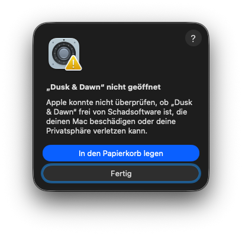
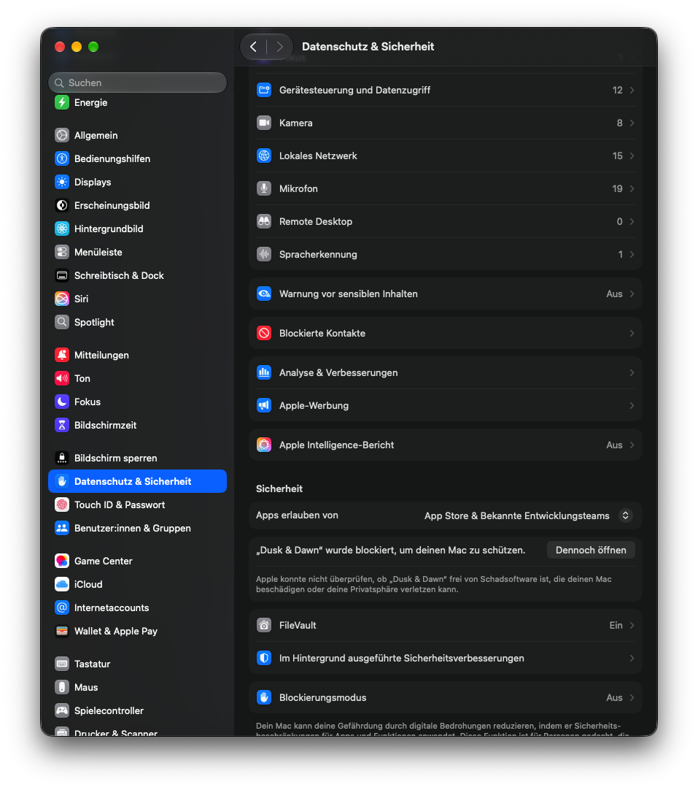
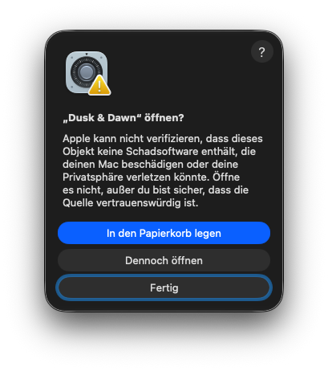
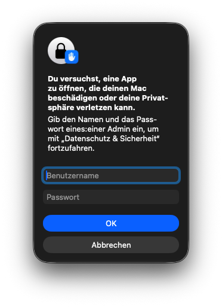

# Dusk & Dawn

Dusk & Dawn macht aus zwei Bildern ein **dynamisches Hintergrundbild für macOS**. Im hellen Modus zeigt der Mac das helle Bild, im dunklen Modus das dunkle, und der Wechsel passiert automatisch.

## Funktionen

- **Zwei Bilder zusammenführen:** Ein helles und ein dunkles Bild in die Felder ziehen und als HEIC exportieren.
- **Gegenstück erzeugen:** Nur ein Bild vorhanden? Die App erkennt, ob es hell oder dunkel ist, und erzeugt die passende andere Variante. Die Stärke lässt sich einstellen.
- **Letzte Ergebnisse:** Die App merkt sich pro Bild die letzten 10 übernommenen Gegenstücke, auch nach einem Neustart.
- **Als Hintergrundbild festlegen:** Nach dem Export direkt als Schreibtischhintergrund verwenden.
- **Updates:** Im Menü „Dusk & Dawn“ → „Nach Updates suchen …“.

Voraussetzung: macOS 13 oder neuer.

## Installation

1. Die DMG öffnen und **„Dusk & Dawn“ auf den Ordner „Programme“ ziehen**.
2. Die App im Ordner „Programme“ per Doppelklick starten.

Beim **ersten Start** meldet macOS, dass die App nicht auf Schadsoftware geprüft werden konnte. Das liegt daran, dass Dusk & Dawn eine kostenlose App ist und nicht über Apples kostenpflichtiges Entwicklerprogramm beglaubigt wurde. So öffnest du sie trotzdem:

**macOS 15 (Sequoia) und neuer**

1. Die Meldung „„Dusk & Dawn“ nicht geöffnet“ erscheint. Auf **„Fertig“** klicken, **nicht** auf „In den Papierkorb legen“.

   

2. **Systemeinstellungen** öffnen → **Datenschutz & Sicherheit** → ganz nach unten scrollen bis zum Abschnitt **„Sicherheit“**. Dort steht „„Dusk & Dawn“ wurde blockiert, um deinen Mac zu schützen.“ Daneben auf **„Dennoch öffnen“** klicken.

   

3. Es folgt die Frage „„Dusk & Dawn“ öffnen?“. Hier auf **„Dennoch öffnen“** klicken.

   

4. Zum Schluss **Benutzername und Passwort** eines Administrators eingeben (meist dein eigenes Benutzerkonto) und auf **„OK“** klicken.

   

Danach startet Dusk & Dawn.

**macOS 13 und 14**

Im Ordner „Programme“ **mit der rechten Maustaste** auf „Dusk & Dawn“ klicken → **„Öffnen“** → in der Meldung noch einmal **„Öffnen“**.

Das ist nur **einmal** nötig. Danach startet die App ganz normal, und Updates über das Menü laufen ohne diese Meldung.

## Selbst bauen

Voraussetzung sind die Xcode Command Line Tools (`xcode-select --install`).

```bash
./build.sh      # baut „Dusk & Dawn.app“ und startet sie
./release.sh    # baut die App und packt sie samt README in Dusk-and-Dawn-<Version>.dmg
```

Die Versionsnummer steht in `build.sh`.
